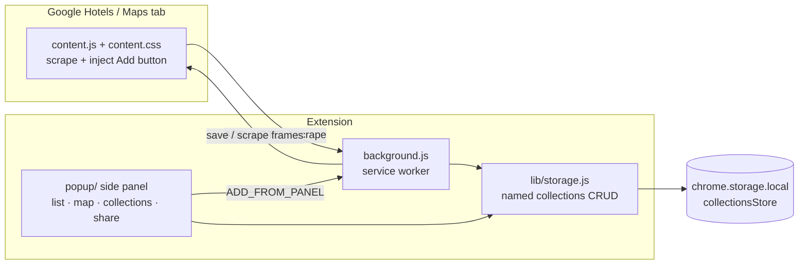

# Hotel Collection — Chrome Extension

Curate hotels from **Google Hotels** into a personal collection. View them on a map that shows **only your saved hotels**, then share via JSON export/import.

## Features

- **Add to collection** — button on the hotel details panel + Chrome right-click menu item
- **Named collections** — e.g. Goa / Ooty / Manali; switch, add, or delete (with confirm)
- **Collection side panel** — list + map (pins only for hotels in the active collection)
- **Drag to reorder** — change rank by dragging; love/dislike do not auto-move
- **Export / Import JSON** — share curated lists via WhatsApp, Drive, email (no server)

## Load in Chrome

1. Open `chrome://extensions`
2. Enable **Developer mode**
3. Click **Load unpacked**
4. Select this folder (`MyPlanner`)
5. Pin **Hotel Collection** from the puzzle menu

After code changes, click the extension’s **reload** button on `chrome://extensions`.

## Use it

1. Open [Google Hotels](https://www.google.com/travel/hotels) and select a hotel so the details panel opens
2. Click **Add to collection** under the hotel name  
   (or right-click the page → **Add to collection** when Chrome’s menu appears)
3. Open the extension side panel — the hotel appears in the list and on the map (if coordinates were found)
4. **Reorder** by dragging hotels in the list (love/dislike only mark preference); click a card to open it
5. **Export** downloads a JSON file; **Import** merges another file (duplicates by URL are skipped)

## Architecture

Chrome MV3 extension — no backend. Data stays in `chrome.storage.local` on the device.



| Piece | Role |
| --- | --- |
| `manifest.json` | MV3 config: permissions, host matches, side panel, content scripts |
| `background.js` | Service worker — context menu, inject scripts, scrape-all-frames, save |
| `content.js` / `content.css` | Runs on Hotels/Maps — scrape place, keep Add button in panel |
| `lib/storage.js` | Named collections, hotels, votes, notes, reorder, export/import |
| `popup/` | Side panel UI — chips, Leaflet map, list, Share/Export |
| `vendor/leaflet/` | Bundled map (no CDN) |
| `icons/` | Extension icons |

**Data model (simplified):** `collectionsStore = { activeId, collections: [{ id, name, hotels[] }] }`  
Legacy single `collection` array is migrated once into “My collection”.

**Main flows**
1. **Add from page** — content scrape → `ADD_HOTEL` → storage (active collection)
2. **Add from panel** — `ADD_FROM_PANEL` → inject/scrape tab frames → storage
3. **Manage** — side panel reads/writes storage (switch collection, vote, note, reorder, clear)
4. **Share** — build JSON → Web Share file if possible, else download + open WhatsApp

## Project layout

```
MyPlanner/
├── manifest.json
├── background.js          # Service worker: menu, inject, scrape, save
├── content.js / content.css
├── lib/storage.js         # Named collections + hotel CRUD
├── popup/                 # Side panel UI
│   ├── popup.html
│   ├── popup.css
│   └── popup.js
├── vendor/leaflet/        # Bundled map library
└── icons/
```

## Notes

- Google Maps often intercepts right-click; use the injected **Add to collection** button if the Chrome menu does not show.
- The side panel map is your curated map only — it does not hide other pins on Google’s own map.
- Scraping selectors can break when Google changes their DOM; scrape logic lives in `content.js`.
- No server: Export / Share / Import are how you back up or move data between devices.
# MyCollection
